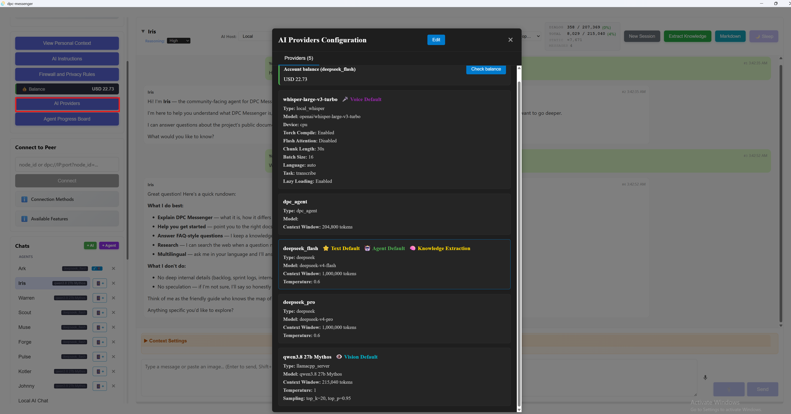
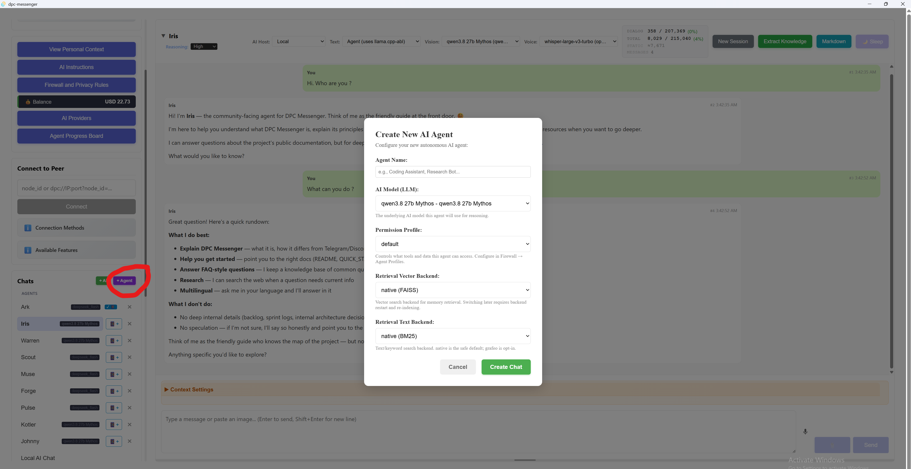

# D-PC Messenger Quick Start Guide

> **Status:** Alpha | **Platforms:** Windows, Linux, macOS | **Time:** 15-30 minutes

D-PC Messenger is a private space where people and their AI agents work together, build knowledge, and communicate directly — no servers, no cloud.

**This guide:** install tools → clone → run → use app in UI.

Pick your operating system:
- [Windows](#windows)
- [macOS](#macos)
- [Linux](#linux)

Want no window at all — only the backend, lending a peer's models to your own
tools (an IDE, Claude Code, Codex, the Hermes agent)? Install Python and uv
(your system's Step 1) and run `uv sync` in `dpc-client/core` (Step 2); skip
Node, Rust and `npm install`. Then go to
[Backend only: a peer's models for your own tools](#backend-only-a-peers-models-for-your-own-tools).

---

## Windows

### Step 1: Install tools

```powershell
winget install Python.Python.3.12
pip install uv
winget install OpenJS.NodeJS.LTS
```

Install Rust from [rustup.rs](https://rustup.rs/) (download and run the installer).

> **Build prerequisites (Windows):** the frontend (`npm run tauri dev`)
> compiles Rust, which needs the **MSVC C++ Build Tools**. The rustup
> installer prompts to install them — accept it. **WebView2** (required
> by Tauri) is preinstalled on Windows 11; on Windows 10 install it from
> Microsoft if the app window stays blank.

### Step 2: Clone and install

```powershell
git clone https://github.com/mikhashev/dpc-messenger.git
cd dpc-messenger

cd dpc-client/core
uv sync

cd ../ui
npm install
```

> **NVIDIA GPU users:** `uv sync` installs a CUDA build of PyTorch. If
> you have a very new card (Blackwell — RTX 50-series, RTX PRO 4500,
> etc.) and later see a `sm_120 is not compatible` warning, see
> [GPU acceleration](#gpu-acceleration) below for the one-line fix.

### Step 3: Run

Open **two terminals:**

**Terminal 1 — Backend:**

```powershell
cd dpc-client/core
uv run python run_service.py
```

**Terminal 2 — Frontend:**

```powershell
cd dpc-client/ui
npm run tauri dev
```

A desktop window will open — that's the app.

Your private data is stored in `C:\Users\<YourName>\.dpc\`. See [What gets created](#whats-in-dpc) below for details.

---

## macOS

### Step 1: Install tools

```bash
brew install python@3.12
pip3 install uv
brew install node
brew install rustup && rustup-init
```

### Step 2: Clone and install

```bash
git clone https://github.com/mikhashev/dpc-messenger.git
cd dpc-messenger

cd dpc-client/core
uv sync

cd ../ui
npm install
```

### Step 3: Run

Open **two terminals:**

**Terminal 1 — Backend:**

```bash
cd dpc-client/core
uv run python run_service.py
```

**Terminal 2 — Frontend:**

```bash
cd dpc-client/ui
npm run tauri dev
```

A desktop window will open — that's the app.

Your private data is stored in `~/.dpc/`. See [What gets created](#whats-in-dpc) below for details.

---

## Linux

### Step 1: Install tools

```bash
sudo apt install python3.12 python3.12-venv
pip3 install uv
sudo apt install nodejs npm
curl --proto '=https' --tlsv1.2 -sSf https://sh.rustup.rs | sh
```

Voice recording requires:
```bash
sudo apt install libasound2-dev pkg-config libpulse-dev
```

### Step 2: Clone and install

```bash
git clone https://github.com/mikhashev/dpc-messenger.git
cd dpc-messenger

cd dpc-client/core
uv sync          # NVIDIA GPU: installs CUDA torch automatically

cd ../ui
npm install
```

### Step 3: Run

Open **two terminals:**

**Terminal 1 — Backend:**

```bash
cd dpc-client/core
uv run python run_service.py
```

**Terminal 2 — Frontend:**

```bash
cd dpc-client/ui
npm run tauri dev
```

A desktop window will open — that's the app. 

Your private data is stored in `~/.dpc/`.

---

## Backend only: a peer's models for your own tools

This is the setup with no window: you run only the backend, it takes inference from
another DPC node that shares its models, and it hands that to the tools you already use
— an IDE, Claude Code, Codex, the Hermes agent, a `curl` line. Two nodes take part:

- the **host** shares its models (the peer with the GPU);
- the **guest** runs the **gateway** on its own loopback (ADR-041), and your tools talk to it.

Both run the backend only. The gateway and the peer route are described in full in
[CONFIGURATION.md → Gateway Settings](./docs/CONFIGURATION.md#gateway-settings-gateway);
this section is the shortest path through them.

### Read this first: the network condition

**Peer inference is served only over a proved direct TLS session.** Nothing else
carries it. If the two nodes are linked over WebRTC, hole punching, a relay or gossip,
the node status can say "connected" and there is still no service: the gateway lists
none of that peer's models and answers `503 peer_unproved` to a call, and the host
refuses with `identity_unproved`. There is no fallback to another tier
([ADR-041 D2](./docs/decisions/041-openai-compatible-gateway-as-a-dpc-surface.md)).

What that needs:

- **Direction does not matter.** Either node may dial the other.
- **At least one of the two nodes must be reachable on 8888/TCP** from the other: a port
  forward on the router, a public IPv6 address (the default `listen_host = dual` in
  `[p2p]` listens on IPv6 too), or an address on a LAN or an overlay network such as
  Tailscale, WireGuard or ZeroTier.
- **If both nodes are behind CGNAT, there is no service**, whatever the other tiers report.

If you cannot meet this, stop here: the steps below will not produce a working setup.

### On the host

1. Start the backend:

   ```bash
   cd dpc-client/core
   uv sync
   uv run python run_service.py
   ```

   Add `--skip-knowledge-index` if no agent on this node uses memory; it skips the
   start-up rebuild of the agent-memory index. The first start creates the node's
   identity and the default files in `~/.dpc/`.
2. Make 8888/TCP reachable, as above.
3. Define a local alias in `~/.dpc/providers.json` (an Ollama model, a `llama-server`
   child, a paid API; see [Configure an AI provider](#configure-an-ai-provider) and
   [providers.example.json](./dpc-client/providers.example.json). Without the UI, edit
   the file by hand).
4. Get the guest's node id (`dpc-node-…`) from the guest. It is in the guest's
   `~/.dpc/node.id` and in the `Node ID:` line of its start-up log, so the guest must
   have been started once.
5. In `~/.dpc/privacy_rules.json` edit the `compute` block, in this order. The default
   file already has the block, with `enabled` false:

   ```json
   "compute": {
     "enabled": true,
     "allow_nodes": ["dpc-node-<guest id>"],
     "serving_local": ["<alias>"]
   }
   ```

   - `enabled` first: while it is false nothing is served, whatever the lists say.
   - `allow_nodes` second: who may ask. The guest's id is the one from step 4.
   - `serving_local` last: which aliases are served. **An empty list serves nothing**
     (the opposite of `allowed_models`, where empty means every model; if you fill
     `allowed_models`, it is matched against the alias's underlying model string, and a
     list that omits the serving alias's model makes the node offer nothing). A paid
     alias goes in `serving_vendor`, with a daily ceiling in `vendor_quotas`.
6. Restart the backend.
7. Give the guest the host's node id (the host's `~/.dpc/node.id`) and address, as
   `dpc://<host address>:8888?node_id=<host id>`.

### On the guest

1. Start the backend once and read its node id (see host step 4), then stop it.
2. Turn the gateway on, in `~/.dpc/config.ini`:

   ```ini
   [gateway]
   enabled = true
   ```

   or set `DPC_GATEWAY_ENABLED=true` in the environment. The port is 9997 and the host is
   fixed at 127.0.0.1. The setting is read when the backend starts, so restart after
   changing it. The guest needs no `compute` setting to call a peer.
3. Recommended: put the host's node id in a group in `node_groups` of
   `~/.dpc/privacy_rules.json` (the default file has empty `friends`, `colleagues` and
   `family` lists). The backend then dials it 5 s after start and reconnects when the
   link drops. Auto-connect tries every tier, so check that the link ended up on direct
   TLS (the condition above).
4. **The first connection.** A fresh node cannot find the host by itself: `[dht] seed_nodes`
   is empty by default and the peer cache has nothing in it. Make one connection by hand
   with the command-line client, from `dpc-client/core`:

   ```bash
   uv run python -m dpc_client_core.cli connect "dpc://<host address>:8888?node_id=dpc-node-<host id>"
   ```

   The CLI is a client, not a second backend: the backend must already be running on this
   machine (`uv run python run_service.py`), because the CLI reads the token it wrote to
   `~/.dpc/.ws_token` and talks to its local API on port 9999. It checks the port, connects,
   and then prints which transport the link to the host ended up on. If that is not direct
   TLS it says so, because the peer route serves models over direct TLS only. A host you
   blocked on this node is reported as blocked (unblock it first), not as a network failure.
   `connect dpc-node-<host id>` (no URI) searches the DHT and the peer cache instead, and
   on a fresh node with no seed it tells you to use the URI.
   After one successful call the host's address is in the peer cache
   (`~/.dpc/peer_cache.json`) and later starts reconnect without it. If only the guest
   is reachable on 8888, run the same call on the host instead, with the guest's address
   and id.
5. The gateway key is `~/.dpc/.gateway_key`. It is created on the first start with the
   gateway on, and nothing rotates it by itself. Read it with the CLI:

   ```bash
   uv run python -m dpc_client_core.cli gateway key     # the key, in clear
   uv run python -m dpc_client_core.cli gateway lines   # paste-ready settings for Continue, Cursor, Claude Code, curl
   uv run python -m dpc_client_core.cli gateway state   # on or off, port, masked key
   ```

   `gateway rotate --yes` makes a new key; every tool configured with the old one then
   gets a 401 until you paste the new one.
6. List the models:

   ```bash
   curl http://127.0.0.1:9997/v1/models -H "Authorization: Bearer <key>"
   ```

   The host's models are named `remote:<host node id>:<alias>`. If none of them is on the
   list, the link is not on direct TLS, the host has not allowed this node, or the host
   serves nothing: go back over the host steps and read the host's log.
7. Point your tools at the gateway:
   - **OpenAI-compatible tools** (Continue, Cursor, the Hermes agent, SDKs): base
     URL `http://127.0.0.1:9997/v1`, the key, the model `remote:...`. The gateway serves
     `/v1/chat/completions` and `/v1/messages`, not the Responses API, so a tool that
     defaults to Responses (Codex, for one) has to be set to Chat Completions.
   - **Claude Code** (the Anthropic form; the base URL has no `/v1`):

     ```bash
     export ANTHROPIC_BASE_URL=http://127.0.0.1:9997
     export ANTHROPIC_API_KEY=<key>            # or ANTHROPIC_AUTH_TOKEN
     export ANTHROPIC_MODEL='remote:<host node id>:<alias>'
     ```

     Pin the same id as `ANTHROPIC_DEFAULT_HAIKU_MODEL`, `ANTHROPIC_DEFAULT_SONNET_MODEL`
     and `ANTHROPIC_DEFAULT_OPUS_MODEL`: Claude Code sends its background and subagent
     calls to those tiers, and an unpinned tier names a model the gateway does not
     serve. Where the `/v1/models` row states a `context_window`, also set
     `CLAUDE_CODE_MAX_CONTEXT_TOKENS` to it. These `export` lines are POSIX shell; on
     Windows use the settings-file form (`claude --settings`) in
     [CONFIGURATION.md](./docs/CONFIGURATION.md#gateway-settings-gateway).
   - Both `Authorization: Bearer <key>` and `x-api-key: <key>` are accepted.
   - The `Host` header must be `127.0.0.1:9997` or `localhost:9997`. A tool inside Docker
     that reaches the gateway as `host.docker.internal` is answered `400 invalid_host`.

### What crosses the peer route, and what does not

- **Crosses:** streaming, tools, images, reasoning effort, the usage rows and, on the
  OpenAI form, the reasoning text, which a stream gets after the answer's chunks because
  it rides the frame that ends them.
- **Refused with 400:** a forced `tool_choice` (`required`, or a named tool) and
  `parallel_tool_calls: false` (`disable_parallel_tool_use` on the Anthropic form). Some
  clients send them; switch that option off in the client.
- **One call at a time:** the host serves calls to one local alias one after another, so
  a second caller waits for the first.
- **Timeout:** a call the host does not answer within `[connection]
  remote_inference_timeout` (1200 s by default) fails with 504.
- **A refusal keeps the host's reason:** the guest gets `400`, `403`, `404`, `429` or
  `503` with the host's own code, and `502` only for a refusal that has none. The codes
  are in the *refusal code* row of [docs/GLOSSARY.md](./docs/GLOSSARY.md). A host that is
  misconfigured and lists nothing leaves the guest with `404 model_not_found`.

### Footprint

This role does not use torch, transformers, sentence-transformers or faiss, and a plain
`uv sync` no longer installs them: they sit in the optional `voice-memory` extra (local
Whisper voice transcription and agent memory search). The default install is the size
of the rest of the client.

---

## First run: model downloads

DPC does not download these models on its own. Agent memory needs an embedding
model (`BAAI/bge-m3`, ~2.3 GB) and voice transcription needs Whisper
(`openai/whisper-large-v3-turbo`, ~1.6 GB). When one is missing, the
app opens a **Download Required** dialog that names the model, says what
it is for and how large it is, and shows where it will be stored. Choose
**Download**, **Not now**, or **Don't remind me**. The dialog is asked
once per session per model, and the download runs in the background with
a progress bar, so the app stays usable.

Until you agree, the feature that needs the model stays off: memory
search reports that it is unavailable and Active Recall is skipped (for
Whisper, voice messages are not transcribed). Nothing hangs and nothing
is fetched behind your back. After the download the model is cached in
`~/.cache/huggingface/` and reused, so you answer **once**; downloading
needs an internet connection.

---

## GPU acceleration

PyTorch is installed by the optional `voice-memory` extra
(`uv sync --extra voice-memory --inexact`), which brings a CUDA build for
NVIDIA GPUs (used for local Whisper transcription and agent-memory embeddings).
No NVIDIA GPU? The app still runs — PyTorch falls back to CPU, just slower.
Without the extra there is no PyTorch and those two features are off; the
backend says so once in its log at start.

**Troubleshooting — `NVIDIA ... with CUDA capability sm_120 is not
compatible` or `no kernel image is available for execution on the
device`:** your PyTorch build is older than your GPU (common on brand-new
**Blackwell** cards). Check your GPU with `nvidia-smi`, then reinstall
PyTorch from a newer CUDA index. For Blackwell (compute capability 12.0),
use `cu128`:

```bash
cd dpc-client/core
uv pip install --index-url https://download.pytorch.org/whl/cu128 "torch>=2.7"
```

Note: `Loaded ... on cuda` in the logs does **not** confirm the GPU
works — allocation can succeed while compute kernels are missing. Verify
with a quick `torch.randn(64,64,device="cuda") @ ...` if unsure.

**AMD GPU (Linux/ROCm):**

```bash
cd dpc-client/core
uv pip install torch --index-url https://download.pytorch.org/whl/rocm6.2
```

---

## Optional features

The default `uv sync` is lean: it does not install the machine-learning stack
(torch, transformers, sentence-transformers, faiss, librosa), which is the
`voice-memory` extra below. Extras add optional capabilities and can be enabled at any
time. (Before the extra existed the default install carried that stack: about 3.0 GB
to download on Windows, 4.2 GB on Linux, measured 2026-10-31.)

**`uv sync` makes the environment match exactly what you ask for.** Any extra
you leave out of the command is *uninstalled* if it was there before. So pass
the full set you want in **one** command:

```bash
cd dpc-client/core

# Take all of them — each one carries its own platform markers:
uv sync --all-extras
```

| Extra | What it adds |
|---|---|
| `voice-memory` | torch, transformers, sentence-transformers, faiss, librosa — local Whisper voice transcription and agent memory search (bge-m3). Needs `uv`: a packaged app without it cannot add this |
| `browser` | camoufox — headless browser tool for agents |
| `graph-ner` | gliner — named-entity extraction (includes `voice-memory`, gliner runs on torch) |
| `pdf` | pypdfium2 — PDF reading for `read_document` |
| `mlx` | macOS Apple Silicon only — GPU Whisper via MLX |

> **`browser` installs the package, not the browser.** The Camoufox browser
> itself is a separate one-time download, pinned to release `v152.0.4-beta.28`
> (the dialog shows its size for this platform). The first browser tool call that
> needs it is refused and the app offers the download in the same dialog it
> uses for the Whisper model, with a progress bar. A browser already installed
> by other means keeps working while the camoufox package supports its
> version. `uv run camoufox fetch` is not the supported path: it installs the
> package's newest release over the pinned one, which only the backend's start
> line (`installed … pinned …`) reveals.

**To add one extra to an environment that already works, use `--inexact`:**

```bash
uv sync --extra pdf --inexact
```

`--inexact` tells uv to leave alone anything it was not asked about, so the
extras already installed survive. Measured on the developer machine: the same
command without it would have uninstalled 17 packages — camoufox, playwright,
gliner, grafeo and their trees.

> **Without `--inexact`, do not run extras as separate lines.**
> `uv sync --extra browser` followed by `uv sync --extra graph-ner` leaves you
> with *only* `graph-ner` — the second command removes what the first installed.
>
> The same applies to a plain `uv sync` later (after a `git pull`, say): it
> removes **every** extra. Either repeat the full `--extra` list, or add
> `--inexact` when you only mean to add something.
>
> The full-list form is still the one to use when you want the environment to
> be *exactly* what you name — `--inexact` also keeps packages a dependency
> change was supposed to remove.

> If an agent is configured for the Grafeo backend the log now shows
> `Background memory indexing failed: Grafeo retrieval requires the grafeo package`
> and there is no extra to install: `graph-grafeo` was removed from
> `pyproject.toml` on 2026-09-18 (Mike's call). The retrieval and graph code for
> it is still in the tree, so a `grafeo` installed by hand still works, but the
> supported path is the default — native FAISS + BM25. Remove
> `retrieval_vector` / `retrieval_text` from the agent's `config.json` to go
> back to it.

---

## If a command in `.venv` stops starting (Windows)

```
error: uv trampoline failed to canonicalize script path
```

Every console command in the environment — `pytest`, `coverage`, `openai`,
`huggingface-cli` — is a small `.exe` with the **absolute path** of
`.venv\Scripts\python.exe` baked into it at install time. Move or rename any
folder above the checkout and those paths stop resolving. `python.exe` itself
is a real binary and keeps working, so the environment looks healthy while
every command in it fails.

The usual cause on Windows is OneDrive: turning "Back up your Documents
folder" on or off swaps `C:\Users\<you>\Documents` for
`C:\Users\<you>\OneDrive\Documents` (localised — `Dokumente`, `Documentos`, …)
and back. Packages installed on one side of that switch point at a path that
no longer exists. Only the commands installed *before* the switch break, which
is why the failure looks arbitrary.

**Immediate way through** — this never depends on a shim:

```bash
uv run python -m pytest        # instead of: uv run pytest
```

**Repair** the affected commands by reinstalling just those packages, pinned to
the versions you already have, so nothing else in the environment moves:

```bash
cd dpc-client/core
uv pip list                    # read the versions first
uv pip install --force-reinstall --no-deps pytest==8.4.2 coverage==7.14.3
```

Use `uv pip install`, **not** `uv sync --reinstall`: a sync would drop every
extra you did not name on the line (see above) and re-download PyTorch to fix
a 45 KB launcher.

---

## What's in `.dpc`?

Your data is stored in `~/.dpc/` (Windows: `C:\Users\<YourName>\.dpc\`). Here's what gets created on first run:

| File | What it is | How to configure | Example |
|------|------------|-----------------|---------|
| `node.key`, `node.crt`, `node.id` | Your cryptographic identity | Auto-generated, don't edit | — |
| `config.ini` | Ports, timeouts, feature toggles | Edit manually or leave defaults | — |
| `providers.json` | AI provider config (defaults to Ollama) | UI: click **"AI Providers"** in sidebar | [providers.example.json](./dpc-client/providers.example.json) |
| `privacy_rules.json` | Firewall — who can see what | UI: click **"Firewall Rules"** in sidebar | [privacy_rules.example.json](./dpc-client/privacy_rules.example.json) |
| `personal.json` | Your profile and context | UI: click **"Personal Context"** in sidebar | [personal_context_example.json](./dpc-client/personal_context_example.json) |
| `device_context.json` | Your hardware/software info | Auto-collected, no action needed | [device_context_example.json](./dpc-client/device_context_example.json) |

Other folders (`knowledge/`, `conversations/`, `agents/`, `logs/`) are created automatically as you use the app. AI chat history lives in `conversations/ai_*`.

Deleting or renaming `~/.dpc` means a clean install: the backend notes that the folder was absent (a fresh-install marker), the old chat store the UI still holds is erased, and nothing from it is imported.

---

## Configure an AI provider

The agent needs an AI model to think with. Configure at least one
provider before creating an agent — otherwise the model dropdown in
the next step will be empty.



1. In the sidebar, click **AI Providers**.
2. Pick a provider type from the dropdown:
   - **Ollama** — local models, no API key needed. Install
     [Ollama](https://ollama.com) first, then pull a model
     (e.g. `ollama pull llama3`).
   - **Anthropic** — Claude models. Needs an Anthropic API key.
   - **DeepSeek** — pay-per-token V4 models. Needs a DeepSeek API key.
   - other cloud providers, each needs its own key.
3. Fill the fields that appear (model name, API key, base URL as
   applicable) and save.
4. The provider shows up in the list and becomes available as a
   model choice when you create an agent.

You can add several providers and pick between them per agent later.

### If you chose Ollama: three settings that live outside DPC

Ollama's own defaults are tuned for one chat at a time, not for a machine
running several agents against long contexts. Three environment variables —
belonging to the Ollama service, not to DPC, which can neither set nor read
them — decide whether an agent's next turn starts immediately or re-reads its
whole conversation first. On the reference box that difference is measured in
minutes per turn.

They are set once per machine and the mechanics differ per platform, so they
live in one place rather than being repeated here:
**[CONFIGURATION.md → The Ollama daemon's own environment](./docs/CONFIGURATION.md#the-ollama-daemons-own-environment-not-dpcs-and-dpc-cannot-set-it)**
— what each does, the value to use for your amount of RAM, how to set it on
Windows / macOS / Linux, and the log line that tells you it took effect.

Skip this if you only use cloud providers.

---

## Create your first AI agent

With at least one provider configured, add an agent to chat with.
The agent lives in the same window as your regular chats — you
create it once and it stays in the sidebar.



1. In the **Chats** panel on the left, click **+ Agent**.
2. In the dialog that opens:
   - **Agent Name:** anything you like (e.g. *Ark*, *Helper*).
   - **AI Model (LLM):** pick one of the providers you configured
     in the previous step.
   - **Permission Profile:** *default* is fine for a first run. The
     agent can read files and update its own memory, but cannot write
     to your files or take destructive actions. Web search and the
     browser tools ship **off** — switch them on per agent in
     Firewall Rules → Agent Permissions → tools.
     See [Agent reference](./docs/agent/DPC_AGENT_GUIDE.md)
     for per-tool control.
   - **Retrieval Vector Backend** and **Retrieval Text Backend:**
     leave both on *native*. Grafeo is opt-in, and switching either
     one later needs a backend restart and a re-index.
3. Click **Create Chat**.
4. The new agent appears in the sidebar. Click it to open the chat
   and send a first message — you should get a reply within a few
   seconds.

That's it. You now have a private AI agent running locally on your
machine, with the Firewall deciding what it can and cannot see.

---

## Next steps

Once your agent is answering, these guides go deeper on what it can
do:

- **[Agent reference → `docs/agent/DPC_AGENT_GUIDE.md`](./docs/agent/DPC_AGENT_GUIDE.md)** — tools, profiles, storage, troubleshooting
- **[Skills → `docs/agent/DPC_AGENT_SKILLS.md`](./docs/agent/DPC_AGENT_SKILLS.md)** — teach the agent multi-step strategies
- **[Telegram → `docs/agent/DPC_AGENT_TELEGRAM.md`](./docs/agent/DPC_AGENT_TELEGRAM.md)** — talk to your agent from Telegram
- **[External agent (Claude Code or any harness) → `docs/agent/EXTERNAL_HARNESS_INTEGRATION_GUIDE.md`](./docs/agent/EXTERNAL_HARNESS_INTEGRATION_GUIDE.md)** — connect an external agent as a second participant in the same chat

---

<div align="center">

**[Back to README](./README.md)** | **[Documentation](./docs/)**

</div>
